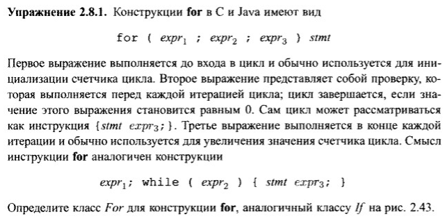

# Задание


# Решение
```java
class For extends Stmt {
    Expr E1, E2, E3; Stmt S;
    public For(Expr e1, Expr e2, Expr e3, Stmt s) {
        E1 = e1; E2 = e2; E3 = e3; S = s;
        loop = newlabel(); after = newlabel();
    }
    public void gen() {
        Expr e1 = E1.rvalue();
        emit(e1.toString());
        emit(loop + ":");
        Expr e2 = E2.rvalue();
        emit("ifFalse " + e2.toString() + " goto " + after);
        S.gen();
        Expr e3 = E3.rvalue();
        emit(e3.toString());
        emit("goto " + loop);
        emit(after + ":");
    }
}
```