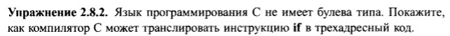

# Задание


# Решение
```java
class If extends Stmt {
    Expr E; Stmt S;
    public For(Expr e, Stmt s) {
        E = e;  S = s; after = newlabel();
    }
    public void gen() {
        Expr n = E.rvalue();
        Rel rel = new Rel("!=", n, new Const(0));
        Expr r = rel.rvalue();
        emit("ifFalse " + r.toString() + " goto " + after);
        S.gen();
        emit(after + ":");
    }
}
```